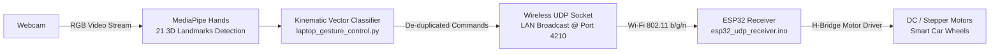

# 🖐️ Wireless Hand Gesture Controller for ESP32 Smart Car / Robotics

[](https://python.org/)
[](https://developers.google.com/mediapipe)
[](https://opencv.org/)
[](https://www.espressif.com/)
[](https://opensource.org/licenses/MIT)

A real-time vision-based wireless teleoperation system. Uses **Google MediaPipe Hands** and **OpenCV** to track 21 3D hand landmarks via a webcam, classifies dynamic hand gestures into directional driving commands, and broadcasts them over low-latency **Wireless UDP** to an **ESP32 microcontroller** driving a smart robotic vehicle.

---

## 📌 System Architecture



---

## 🖐️ Gesture Command Mapping

| Gesture | Landmark Vector Condition | Command Code | Vehicle Action |
| :---: | :--- | :---: | :--- |
| ☝️ **Point Up** | Index extended vertically ($\Delta y < -0.05$) | `'F'` | **Forward** |
| 👇 / ✊ **Fist / Point Down** | 0 fingers extended or index $\Delta y > 0.05$ | `'B'` | **Backward** |
| 👈 **Point Left** | Index pointing screen-left ($\Delta x < -0.05$) | `'L'` | **Turn Left** |
| 👉 **Point Right** | Index pointing screen-right ($\Delta x > 0.05$) | `'R'` | **Turn Right** |
| ✋ **5 Fingers Open** | $\ge 4$ extended fingertips | `'S'` | **Stop / Hold** |

> **Low-Latency Optimization:** Packets are only transmitted over the UDP socket when the classified state changes (`command != last_command`), preventing network congestion while maintaining sub-millisecond response time.

---

## 🚀 Getting Started

### 1. Flash the ESP32 Receiver
1. Open `esp32_receiver/esp32_udp_receiver.ino` in Arduino IDE.
2. Enter your Wi-Fi SSID and Password:
   ```cpp
   const char* ssid = "YOUR_WIFI_SSID";
   const char* password = "YOUR_WIFI_PASSWORD";
   ```
3. Upload to your ESP32 board and open the Serial Monitor (115200 baud) to view its local IP address (e.g., `192.168.1.50`).

### 2. Launch the Gesture Controller
1. Clone the repository and navigate into the directory:
   ```bash
   cd HANDGESTURE
   ```
2. Set up virtual environment and install dependencies:
   ```bash
   python3 -m venv venv
   source venv/bin/activate
   pip install -r requirements.txt
   ```
3. Update `ESP32_IP` in `laptop_gesture_control.py` with your ESP32's IP address:
   ```python
   ESP32_IP = "192.168.1.50"
   ESP32_PORT = 4210
   ```
4. Run the gesture controller:
   ```bash
   python laptop_gesture_control.py
   ```
   *Hold your hand in front of the camera. Press `q` to safely exit.*

---

## 📁 Repository Structure

```text
├── README.md                           # Documentation & gesture mapping guide
├── requirements.txt                    # OpenCV & MediaPipe dependencies
├── .gitignore                          # Virtual environments and cache ignore
├── laptop_gesture_control.py           # Real-time computer vision & UDP teleoperation script
└── esp32_receiver/
    └── esp32_udp_receiver.ino          # ESP32 wireless UDP listener & motor driver bridge
```
